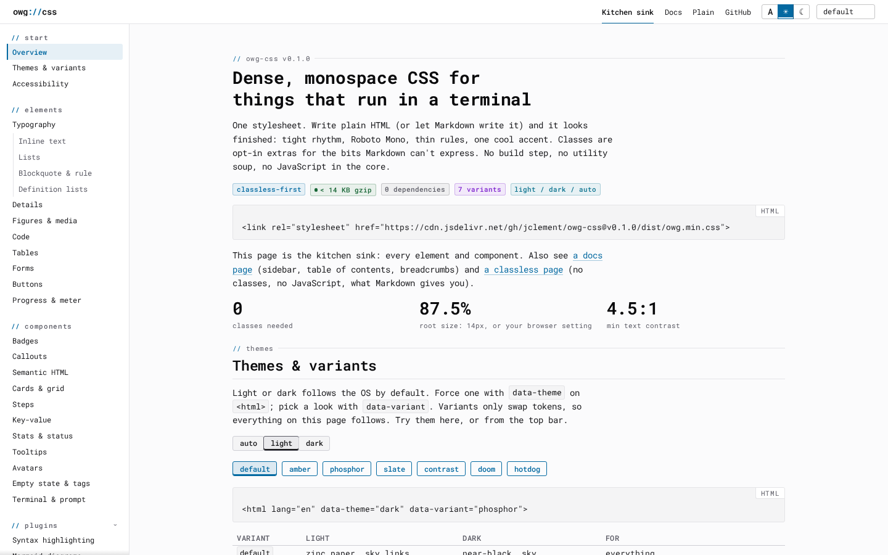
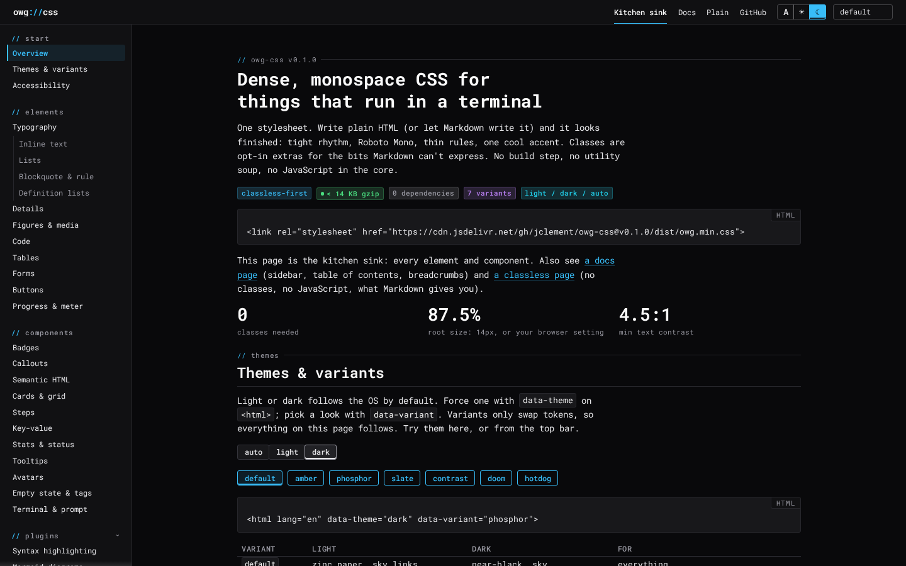
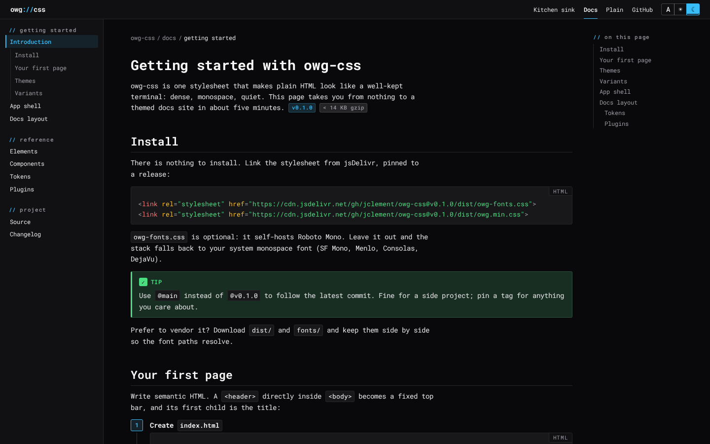
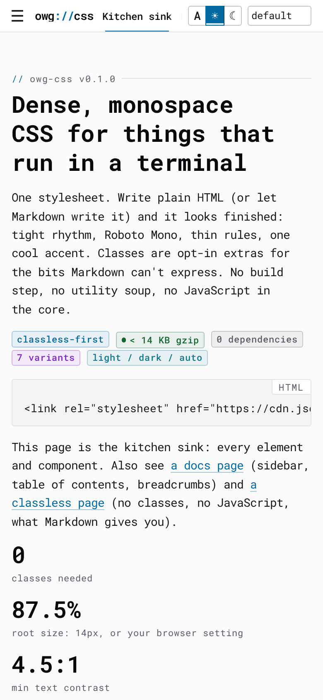
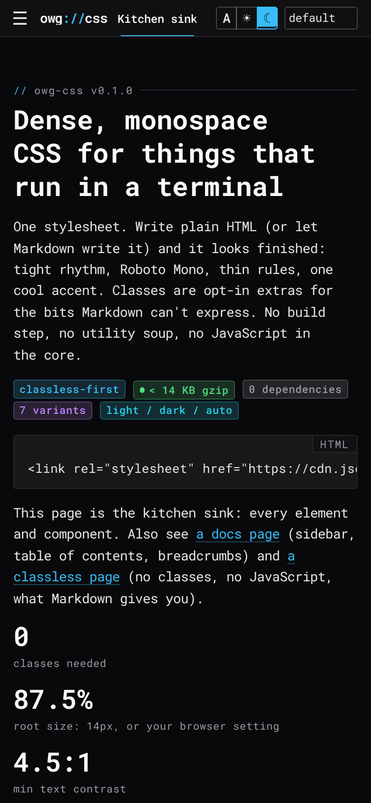
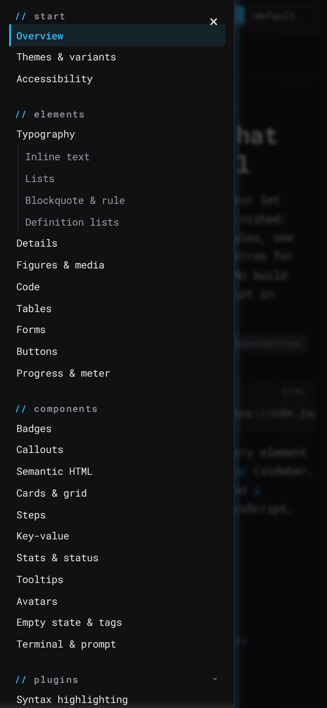
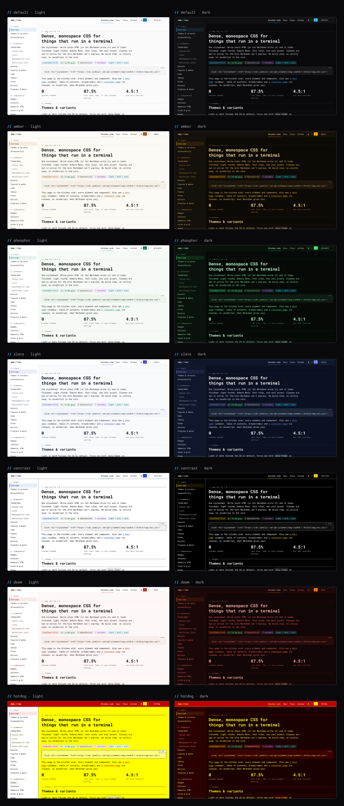
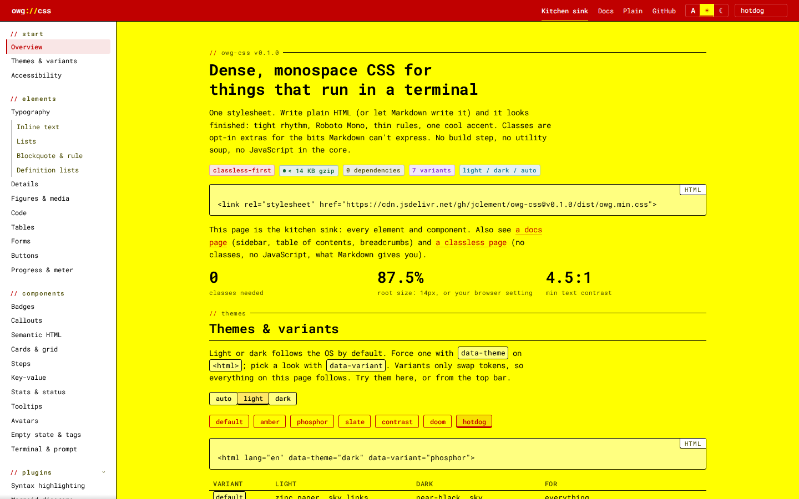

# owg://css

A small, dense, monospace stylesheet for the things I build: self-hosted tools, homelab
dashboards, project docs, the blog. Link one file and plain HTML (or whatever your Markdown
renderer spits out) looks deliberate: Roboto Mono, tight rhythm, thin rules, one cool accent,
light and dark. Think Pico or Simple.css, but for people who live in a terminal. No build step,
no utility classes, no JavaScript in the core. Tailwind is great; this is not that.

**Demo:** <https://jclement.github.io/owg-css/> ·
[kitchen sink](https://jclement.github.io/owg-css/) ·
[docs page](https://jclement.github.io/owg-css/docs.html) ·
[classless page](https://jclement.github.io/owg-css/plain.html)




<details>
<summary>More screenshots: docs layout, phone, every variant, hotdog</summary>



| Phone | Phone, dark | Drawer open |
|---|---|---|
|  |  |  |





</details>

## Quick start

```html
<link rel="stylesheet" href="https://cdn.jsdelivr.net/gh/jclement/owg-css@v0.1.0/dist/owg-fonts.css">
<link rel="stylesheet" href="https://cdn.jsdelivr.net/gh/jclement/owg-css@v0.1.0/dist/owg.min.css">
```

That's it. `owg-fonts.css` self-hosts Roboto Mono; leave it out to use the system monospace
font. To track the latest commit instead of a release, use `@main`:

```html
<link rel="stylesheet" href="https://cdn.jsdelivr.net/gh/jclement/owg-css@main/dist/owg.min.css">
```

A complete page:

```html
<!doctype html>
<html lang="en">
<head>
  <meta charset="utf-8">
  <meta name="viewport" content="width=device-width, initial-scale=1">
  <link rel="stylesheet" href="https://cdn.jsdelivr.net/gh/jclement/owg-css@v0.1.0/dist/owg.min.css">
</head>
<body>
  <header>                                  <!-- fixed top bar -->
    <a href="/">relic<span>://</span>status</a>   <!-- title; the span is the accent -->
    <nav><a href="/logs">Logs</a> <a href="/about">About</a></nav>
  </header>
  <main>
    <h1>All systems normal</h1>
    <p>Everything here is plain HTML.</p>
  </main>
  <footer>relic · uptime 41d</footer>
</body>
</html>
```

## Themes and variants

Light or dark follows the OS. Force one, or pick a variant, on `<html>`:

```html
<html data-theme="dark" data-variant="phosphor">
```

| `data-variant` | Look |
|---|---|
| *(none)* | zinc neutrals, sky accent (the owg.me look) |
| `amber` | warm paper / amber CRT |
| `phosphor` | green phosphor terminal |
| `slate` | blue-grey, easy on long docs |
| `contrast` | maximum contrast, for projectors and tired eyes |
| `doom` | bone, rust and hellfire |
| `hotdog` | Windows 3.1 Hotdog Stand. You asked for this. |

Every variant has a light and a dark form and keeps body text at 4.5:1 or better.

### The theme switch (optional)

`plugins/owg-theme.js` (~3 KB, ~1.2 KB gzipped, no dependencies) remembers the visitor's choice
and applies it before the first paint. Load it in `<head>`, not deferred:

```html
<script src="https://cdn.jsdelivr.net/gh/jclement/owg-css@v0.1.0/dist/plugins/owg-theme.js"></script>

<div role="group" aria-label="Theme">
  <button data-theme-set="auto">auto</button>
  <button data-theme-set="light">light</button>
  <button data-theme-set="dark">dark</button>
</div>
<select data-variant-select aria-label="Variant">
  <option value="">default</option>
  <option value="phosphor">phosphor</option>
  <option value="hotdog">hotdog</option>
</select>
```

Buttons get `aria-pressed` to match the current state. From script:
`owgTheme.set('auto'|'light'|'dark')`, `owgTheme.variant('slate'|null)`, `owgTheme.get()`;
an `owg:theme` event fires on `document` after each change. It also closes the sidebar drawer
on <kbd>Esc</kbd> or a click outside.

## App shell and docs layout

A `<header>` directly in `<body>` is the fixed top bar. Add an `<aside>` beside it and you get a
sidebar; under 960px it turns into a drawer opened by a plain `#sidebar` link, so it works with
JavaScript off.

```html
<header>
  <a href="#sidebar" class="sidebar-toggle" aria-label="Open menu">☰</a>
  <a href="/">owg<span>://</span>css</a>
  <nav><a href="/docs/" aria-current="page">Docs</a></nav>
</header>
<aside id="sidebar">
  <a href="#" class="sidebar-close" aria-label="Close menu">×</a>
  <nav>
    <h2>Getting started</h2>                <!-- group label, drawn as // label -->
    <ul>
      <li><a href="#install" aria-current="page">Install</a></li>
      <li><a href="#usage">Usage</a><ul><li><a href="#themes">Themes</a></li></ul></li>
    </ul>
  </nav>
</aside>
<main>
  <article> ...your doc... </article>
  <nav class="toc">                          <!-- sticky right column above 1200px -->
    <h2>On this page</h2>
    <ul><li><a href="#install">Install</a></li></ul>
  </nav>
</main>
<footer> ... </footer>
```

## Components cheat sheet

Everything below is opt-in. Plain elements (headings, lists, tables, forms, `details`,
`blockquote`, `kbd`, `pre`, `figure`, `progress`, `meter`…) need no classes at all.

| Want | Markup |
|---|---|
| Badge | `<span class="badge green">ok</span>` · colours `accent blue green amber red purple pink cyan` · `.solid` · `.dot` |
| Callout | `<aside class="callout warning"><p class="callout-title">Warning</p>…</aside>` · `note tip important warning danger` (+ `info success caution`) |
| Collapsible callout | `<details class="callout tip"><summary>Tip</summary>…</details>` |
| GitHub alerts | `.markdown-alert.markdown-alert-note` etc. are styled as-is |
| Section label | `<p class="label">config</p>` → `// config ─────────` |
| Card | `<article class="card"><header>…</header>…<footer>…</footer></article>` |
| Grid | `<div class="grid">` (auto-fit) · `.grid.cols-2` `.cols-3` `.cols-4` |
| Terminal | `<pre class="terminal" data-title="~/code"><span class="prompt">$</span> make</pre>` · `.output` |
| File block | `<figure class="file"><figcaption>app.ts</figcaption><pre>…</pre></figure>` |
| Code language label | `<pre data-lang="yaml">` |
| Steps | `<ol class="steps">` |
| Key-value rows | `<dl class="kv"><dt>host</dt><dd>relic</dd></dl>` · inline pairs: `<dl class="inline">` |
| Stat | `<div class="stat"><strong>99.9%</strong> <span>uptime</span></div>` |
| Status dot | `<span class="dot green"></span>` |
| Tooltip | `<button data-tooltip="Saves and restarts">` · `data-placement="bottom"` |
| Avatar | `` |
| Buttons | `button` · `.secondary .outline .ghost .danger .small .large` · `a.button` · `aria-busy="true"` · `[role=group]` joins |
| Tables | `td.num` · `table.striped .compact .bordered` · wrap in `<figure>` to scroll |
| Forms | `aria-invalid="true|false"` · `role="switch"` on a checkbox · `[role=group]` for input + button |
| Breadcrumb / pager | `nav.breadcrumb > ol` · `nav.pagination` with `rel="prev|next"` links |

The [kitchen sink](https://jclement.github.io/owg-css/) shows every one of these in every
variant.

## Plugins

All optional, all in `dist/plugins/`:

- **`owg-highlight.css`**: colours for highlight.js, Prism and Shiki (css-variables theme),
  taken from the theme tokens, so code follows the variant. Diffs are tinted.

  ```html
  <link rel="stylesheet" href="https://cdn.jsdelivr.net/gh/jclement/owg-css@v0.1.0/dist/plugins/owg-highlight.min.css">
  <script src="https://cdnjs.cloudflare.com/ajax/libs/highlight.js/11.11.1/highlight.min.js"></script>
  <script>hljs.highlightAll();</script>
  ```

- **`owg-mermaid.js`**: renders `pre.mermaid` blocks with the current palette and Roboto Mono,
  and re-renders when the theme or variant changes.

  ```html
  <script src="https://cdn.jsdelivr.net/npm/mermaid@11.4.1/dist/mermaid.min.js"></script>
  <script src="https://cdn.jsdelivr.net/gh/jclement/owg-css@v0.1.0/dist/plugins/owg-mermaid.js"></script>
  ```

- **`owg-theme.js`**: the theme and variant switch above.

## Customising

Everything is a `--owg-*` custom property on `:root` (see [`src/tokens.css`](src/tokens.css)).
Element defaults sit in `:where()`, so your own CSS wins without a fight.

```css
:root {
  --owg-font-size: 15px;   /* every size is rem, so this scales the lot */
  --owg-radius: 0;
  --owg-accent: #c2410c;
}
```

## Size

| File | Raw | Gzip |
|---|---|---|
| `owg.min.css` | target < 25 KB | ~6 KB |
| `owg-theme.js` | 3.0 KB | 1.2 KB |

Exact numbers for every file are in [`dist/sizes.json`](dist/sizes.json), written by each build.
`mise run check` fails if `owg.min.css` passes 32 KB.

## Browser support

The last two years of evergreen browsers: Chrome, Edge, Firefox, Safari (desktop and iOS).
It leans on `:has()`, `color-mix()` and `:where()`; older browsers get readable, plainer pages.

## Development

Tasks run through [mise](https://mise.jdx.dev):

| Command | Does |
|---|---|
| `mise run setup` | install dev dependencies and Playwright's Chromium |
| `mise run build` | `src/` → `dist/owg.css`, `owg.min.css`, `owg-fonts.css`, `plugins/` |
| `mise run dev` | rebuild on change and serve <http://localhost:4173/demo/> |
| `mise run check` | build, size budget, contrast check for every theme × variant |
| `mise run screenshots` | re-shoot `docs/screenshots/*.png` from the demo |
| `mise run single` | `dist/demo-single.html`: the kitchen sink with everything inlined |

The demo pages in `demo/` load `../dist/`, so open `demo/index.html` straight from a checkout
after a build. Pushing to `main` publishes `demo/` to GitHub Pages
(`.github/workflows/pages.yml`); every PR runs `mise run check`.

## Licence

MIT, © Jeff Clement. Roboto Mono is by Christian Robertson and licensed under the
[SIL Open Font License 1.1](fonts/OFL.txt).
